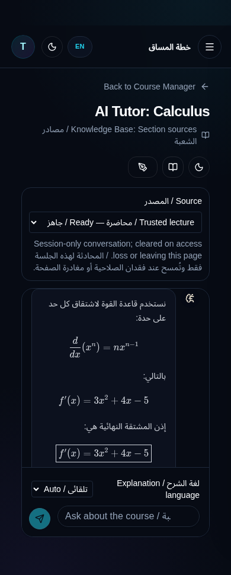
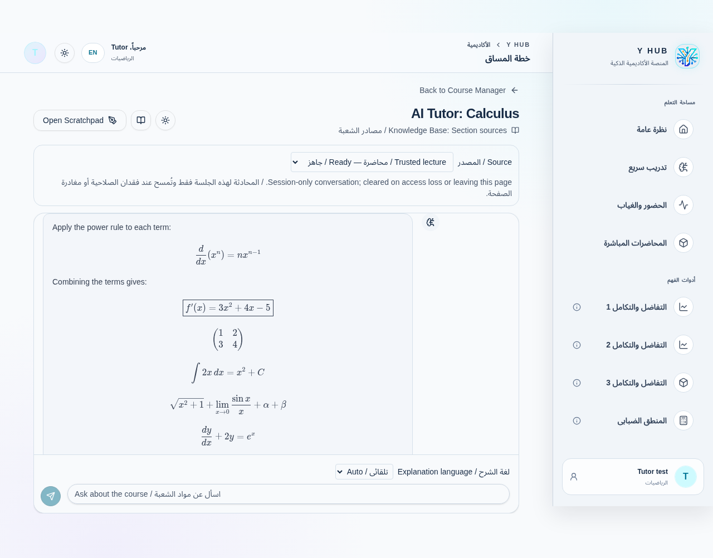

# Tutor math presentation and Arabic explanations

Follow-up on `feature/ai-tutor-rag`, preserving verified remote checkpoint `60cb76360529c44ca1d2124a926b1f6416a2ef0f`. This is a presentation/language/retrieval improvement to the existing Tutor, not a second Tutor or a math-engine implementation.

## Implemented behavior

- Reuse ReactMarkdown, remark-math and KaTeX for both student and assistant messages. Normalize `\(...\)`, `\[...\]`, `$...$` and `$$...$$`; one-line dollar displays become actual display blocks. No global backslash unescaping is performed, so fractions and matrix row separators survive JSON decoding intact.
- A small delimiter scanner preserves fenced code (including longer fences and unfinished fences), backtick code spans, indented code and escaped dollar signs. Explicit code remains code, including LaTeX source explicitly placed in code fences. Unmarked plain text is not guessed to be mathematics; the model is instructed to delimit every mathematical expression.
- Arabic prose has RTL direction independent of leading Latin mathematical symbols; English prose stays LTR. Scoped CSS isolates math and code as LTR. Long inline/display math scrolls inside the message rather than expanding the page. Mobile bubbles use the available width. Fractions, roots, derivatives, integrals, limits, Greek symbols, ODE notation and multi-row matrices are tested.
- Invalid LaTeX produces a safe error representation without crashing. KaTeX trust is disabled and expansion bounded. Raw HTML, remote model images and model-controlled links remain disabled. The scanner is not an arbitrary math parser and does not claim complete TeX support beyond KaTeX.
- Explanation language can be Auto, Arabic or English. Auto detects Arabic explanatory prose while ignoring code/math labels; mixed Arabic/English prose is answered in Arabic. The enum is validated on the server and never becomes a free-form system instruction. The current question, original source snippets and variable names are not translated or rewritten. The choice resets when changing account/course and is not persisted across accounts.
- The server prompt explicitly requires named rules, intermediate transformations and a clear conclusion; principal equations are separate display math, never triple-backtick blocks. Actual programming requests retain code fences. JSON-escaping examples preserve backslashes and matrix line breaks. Trusted citation IDs, access revalidation, quotas and source revision checks remain in place. A model instruction is not a mathematical correctness guarantee or a claim that engines were called.

## Arabic retrieval — new migration 0039

`0039_ai_tutor_arabic_search.sql` adds a normalized generated search vector and GIN index, without changing original chunk text, provenance, IDs, embeddings or RLS. It normalizes Unicode compatibility forms, removes Arabic diacritics/tatweel and folds common alef/ya variants **only for retrieval**. Bounded OR queries ignore common Arabic/English question words so an unmatched English term does not discard every Arabic result. More matching terms increase rank; semantic ranking/model isolation and the six-result limit remain intact.

This trades the old all-words requirement for broader candidate recall. It is orthographic normalization, not complete Arabic morphology, cross-language translation or a validated Arabic semantic benchmark. Citation evidence still contains the exact original text, including its diacritics, and the model must decline unsupported answers.

0038 was not edited. 0039 was applied only to disposable local databases, after the repository migration history was checked for numbering collisions. Production ledger confirmation/application remain pending. Adding a stored generated column computes values for existing rows and builds an index; assess table size/lock time on approved staging before deployment. The old search column/index remain for compatibility. Do not apply unrelated pending migrations automatically.

## Verified results

| Check | Result |
| --- | --- |
| Focused AI Tutor Vitest | **99 passed / 12 files** |
| Complete Vitest suite | **1994 passed / 229 files** |
| Existing application Python | **36 passed** |
| Architecture guards and audits | **8 guard tests passed**; feature/module/math audits passed |
| Complete workspace TypeScript | Passed |
| Production Vite build | Passed; existing large-chunk warning remains |
| Edge Deno typecheck | Both entry points passed |
| Native local Auth/JWT/PostgREST/PostgreSQL Tutor suite | **20 passed**, including Arabic normalization/unaltered evidence and mixed-language recall, plus prior RLS/revocation/concurrency/source-isolation cases |
| Chromium | **5 scenarios passed**: desktop/mobile, light/dark, automatic Arabic/English and manual overrides in both directions |

The complete script is `scripts/verify-architecture-refactor.sh`. The final mobile-width class adjustment was subsequently checked by the focused suite, full workspace TypeScript, build and all five browser scenarios; no mathematical algorithms changed. A regression test initially caught normalization inside indented programming code; the scanner was corrected before final verification.

Browser assertions inspect actual computed LTR math direction, RTL/LTR prose attributes, KaTeX matrices, both message roles, no unexpected KaTeX errors, preserved Python code, horizontal scrollability of a 70-term equation and no document overflow. Existing source selection, management controls and conversation clearing after access denial still pass. Screenshots below were visually inspected.





These are **actual Chromium renders of controlled HTTP fixtures**, not live model answers. A server-handler test also round-trips an Arabic JSON answer containing LaTeX and real fixture citation IDs. Live Groq generation/Arabic teaching quality remains unverified because the required approved provider/staging setup is unavailable. The SQL suite uses actual local GoTrue and PostgREST; it is not evidence of hosted Supabase deployment. No Edge Function or migration was deployed to production, and no main merge occurred.

Reproduce:

```bash
pnpm --filter y-hub exec vitest run src/features/ai-generator --maxWorkers=2 --minWorkers=1
bash scripts/verify-architecture-refactor.sh
bash scripts/test-ai-tutor-http.sh
deno check --config artifacts/y-hub/supabase/functions/deno.json artifacts/y-hub/supabase/functions/ai-tutor-chat/index.ts artifacts/y-hub/supabase/functions/ai-tutor-index/index.ts
# Run local Vite on 127.0.0.1:5175; external browser traffic is intercepted.
YHUB_PLAYWRIGHT_MODULE=/workspace/.yhub-browser/node_modules/playwright-core/index.mjs node scripts/test-ai-tutor-browser.mjs
```

## Changed files

Renderer: `ChatMessageContent.tsx`, new `mathMarkdown.ts` and `chatMath.css`; UI flow: `AITutorChatPanel.tsx`, `AITutorPage.tsx`, `useAITutor.ts`, `aiTutorClient.ts`, `generateTutorReply.ts`; server: `core.ts` and new `teaching.ts`; SQL: new 0039. Renderer, language, server evidence and reply tests plus `test_tutor.py` and the existing browser script were expanded. Documentation/handoff and two screenshots record the results. No other feature, engine, historical migration, dependency or Vercel setting changed.

Deployment remains gated by approval. Deploy the updated Edge handler before enabling the new manual-language frontend, since the old handler rejects unknown request fields; omission/Auto remains backward compatible. Coordinate migrations 0038/0039 with the actual approved ledger. Existing Phase 1 provider/Storage/Edge gates remain pending; this follow-up does not implement Phases 2/3 or make a production-readiness claim.
