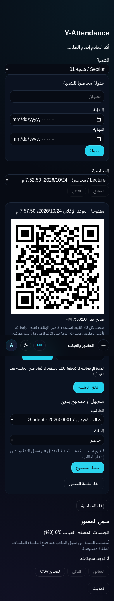
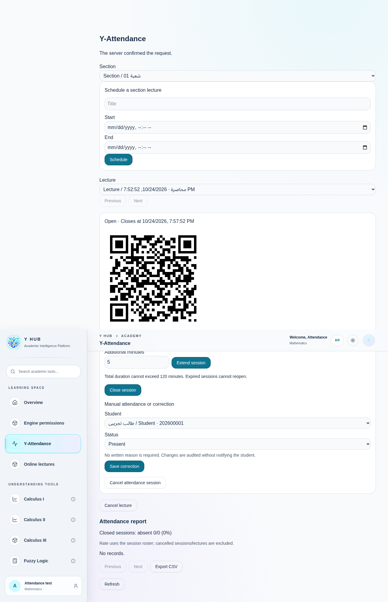

# المجموعة العملية الأولى — دورة جلسة الحضور

الأساس: `main` عند `b41b44875d9febc531a16c1eaa1e1f343593cc3a`، الفرع `feature/approved-attendance-lifecycle`. مصدر التكليف [الوثيقة المعتمدة](APPROVED_2026-10-24.md) مع تصريح المستخدم اللاحق بتنفيذ1–71. [جدول القرارات كاملًا](PROGRESS.md) يميز خط الأساس والنتيجة؛72–80 لم تنفذ.

## ما تغير فعلًا

قبل التعديل: QR ثابت10ثوانٍ، زمن الحضور مرتبط بنهاية المحاضرة، سبب إلزامي للتصحيح، نافذة7أيام للدكتور وحالة excused، ويمكن أن يضيف QR أو التصحيح طالبًا انضم بعد بداية الجلسة إلى أساس النسبة. إلغاء الحضور مستقلًا عن المحاضرة غير متاح.

بعد التعديل:

- القرار2 و35: فترة QR10–120ثانية مع قيم10/15/30/60؛ موثقة في الجلسة ومتحقق منها في الخادم. لا يعتمد التحقق على ساعة جهاز الطالب.
- القرار5 و36: مدة1–120دقيقة (افتراضي10 وقيم5/10/15/30/60)، تمديد ضمن إجمالي120دقيقة، وإغلاق مبكر. لا يعاد فتح جلسة منتهية/ملغاة، والإعادة المتزامنة للفتح تعيد نفس الجلسة.
- القرار6: يُلتقط المؤهلون في نفس لقطة قاعدة البيانات التي تنشئ الجلسة. تبدأ حالتهم absent مؤقتة، وتصبح نهائية عند الموعد أو الإغلاق؛ التعديل اليدوي باقٍ.
- القرار3 و8: تصحيح الحضور دون سبب إلزامي أو حد7أيام، للمخوّل الحالي فقط. يمكن للخدمات القديمة إرسال سبب اختياري محدود ومنقح في التدقيق. الإعادة المتطابقة لا تولد حدث تعديل إضافيًا.
- القرار10: إلغاء جلسة الحضور مستقلًا عن المحاضرة، مع الاحتفاظ بالسجلات والتدقيق والاستبعاد من النسب. إلغاء المحاضرة القديم باقٍ.
- القرار4 جزئي: الكتابة الجديدة حاضر/غائب فقط. لا نحول سجلات excused التاريخية إلى حالة مختلفة دون سياسة معتمدة؛ تظل قابلة للقراءة.
- القرار37 جزئي تاريخيًا، مكتمل للجلسات الجديدة: المنضم بعد بداية الجلسة لا يدخل أساس النسبة ولا يسجل فيها؛ المنسحب يحتفظ بتاريخه ولا يستطيع تسجيل حضور جديد. السجلات القديمة لم تتضمن دليلًا كافيًا لإعادة بناء أهلية لحظة البداية؛ لا نختلقها.
- القرار9 موجود ومحفوظ: لا إشعارات للطلاب عن هذه العمليات؛ التدقيق داخل المعاملة مطلوب.
- إعادة استخدام أرقام0018 ذات التسعة أرقام في قائمة الحضور والتقرير وCSV دون إصدار هوية جديدة. هذا لا يُغلق قرار11 الخاص ببحث المحركات عبر الشعب.

الواجهة العربية/الإنجليزية الحالية توسعت بمكون `AttendanceSessionPanel`؛ لا صفحة أو Module مكرر. تُسحب قائمة التصحيح عند فشل إعادة التحقق، وQR القديم يختفي حسب صلاحيته. التقرير يحدث كل15ثانية، والجلسة كل5ثوانٍ؛ **التفويض ومنع الحضور بعد الأجل فوريان في الخادم**، وليسا معتمدين على هذه المؤقتات. لا تعديلات على المحركات أوQuick Access أوY-Sheets أوألوانها.

## عقد الانتهاء والترحيل

ترحيل جديد فقط: `0040_attendance_session_lifecycle.sql`. لم تتغير الملفات0001–0039 ولم ينفذ SQL على الإنتاج.

- `expires_at` هو موعد الإغلاق المنطقي، و`qr_interval_seconds` فترة QR. `get_attendance_session` و`attendance_report` يحسبان الحالة الفعلية بوقت PostgreSQL، وRPC الخاص بالحضور يرفض الطلب فور انتهاء الأجل، حتى دون متصفح/cron.
- حقل `state` الخام يبقى وصف الإغلاق/الإلغاء الصريح؛ قد يبقى `open` بعد الموعد. **لا تستخدم SELECT state وحده لتحديد الصلاحية**. لا ندّعي أن معاملة تلقائية أو حدث تدقيق مستقل حدث بالضبط عند الموعد؛ الموعد نفسه مسجل ومدقق وكل تغيير له مدقق.
- ترحيل التاريخ ينسخ موعد المحاضرة القديم إلى expires_at ويحافظ على الأرقام والمعرفات والسجلات. لا يمحو excused ولا يعيد إسناد أهلية قديمة.
- تبقى أسماء RPC القديمة صالحة، بما فيها `open_attendance` الذي يستخدم القيم الافتراضية الجديدة و`attendance_session_roster` ذو العمودين. أضيفت `open_attendance_v2` و`get_attendance_session` و`extend_attendance` و`cancel_attendance` و`attendance_session_roster_v2`.
- الدوال المعدلة SECURITY DEFINER لها search_path فارغ، تستمد الممثل من auth.uid وتفحص الدور/الشعبة الحالية. عمليات الإدارة تقفل الممثل والشعبة ثم الجلسة؛ القراءة الجديدة invoker مع RLS، وكتابة الجداول المباشرة والأسرار غير متاحة للأدوار التطبيقية. لا مفاتيح أو محتوى سري في الواجهة.
- لقطة بدء الجلسة هي الطلاب النشطون المثبتون في snapshot عبارة الإنشاء، لا وقت المحاضرة المجدول ولا إعادة حساب العضوية الحالية. لا تسمح دوال التصحيح وQR بإضافة عضو متأخر؛ استمرار التسجيل الحالي مطلوب لـQR، والتصحيح التاريخي للمخوّل الحالي لا يحتاج إعادة تفعيل التسجيل.

قبل نشر مصرح به: تأكيد ledger، تقدير قفل ALTER/backfill على الجلسات، مراجعة التاريخ على staging، وتطبيق0040 قبل الواجهة الجديدة. لا قاعدة Staging معزولة مؤكدة حاليًا؛ التشغيل المستضاف **PENDING**.

## نتائج الاختبارات والأدلة

| الفحص | النتيجة |
|---|---|
| `bash scripts/verify-architecture-refactor.sh` | PASS |
| Vitest الكامل | **2002 ناجح /230 ملف** |
| منها اختبارات واجهة الحضور | **13 ناجح** (8 جديدة) |
| Python للمحركات/الخادم | **36 ناجح** |
| اختبارات الحدود المعمارية | **8 ناجحة** + audits strict/math/modules |
| TypeScript لجميع حزم workspace والبناء الإنتاجي | PASS؛ تحذير حجم chunks قائم |
| `bash scripts/test-university.sh` | **45 ناجح** في PostgreSQL معزول + تحقق ثبات أرقام0018 |
| `bash scripts/test-attendance-http.sh` | **5 ناجحة** عبر GoTrue/JWT وPostgREST وPostgreSQL حقيقية محلية |
| `scripts/test-attendance-browser.mjs` | **2 ناجحان**:390px عربي/غامق،1280px إنجليزي/فاتح |

الاختبارات الجديدة للـSQL تغطي الحدود، استقلال المدتين، التصحيح القديم دون سبب، رفض excused، أهلية البداية/الانسحاب، الإغلاق دون متصفح، التمديد والإلغاء، التزامن، منع صلاحيات شعبة أخرى، فشل التدقيق والتراجع، عدم تكرار التدقيق، وعدم إشعار الطالب. قبل0040 فشلت7 حالات وأخطأت1 من الحالات الجديدة على البنية القديمة؛ الإصلاح اجتازها. عُدّل توقع اختبار قديم كان يطلب excused ورفض التصحيح بعد7أيام ليتوافق مع القرارات المعتمدة، مع الحفاظ على اختبار التنقيح والتدقيق.

اختبارات HTTP تستخدم حسابات اصطناعية محلية وأدوارًا مهيأة داخل قاعدة الاختبار فقط، وتتحقق من الطالب/الدكتور/Admin/Owner وعزل التدقيق وJWT القديم بعد سحب الدور. إنشاء شعبة fixture يجرى بـSQL محلي بسبب فجوة الإنشاء الأكاديمي الموضحة أدناه؛ **لا تدّعي هذه الاختبارات نجاح مسار إنشاء شعبة عبر HTTP**. اختبارات المتصفح تختبر React/CSS والتفاعل الحقيقيين باستجابات HTTP مضبوطة وتمنع الاتصالات الخارجية؛ ليست اختبارات Supabase مستضاف.

### فشل سابق مثبت لم يخفَ أو يعطل

`supabase/tests/integration/test_http.py` فشل في **15 من21 اختبارًا (6 ناجحة)** على نسخة أرشيف منفصلة من `origin/main b41b448` **دون0040**. السبب المتكرر HTTP404/PGRST202: غياب `create_course_definition` و`create_academic_section` من ترحيلات main، بينما الاختبار يستخدم عقد Phase3. الرقمـان0031/0032 محجوزان على عمل Phase3 لكنهما غير موجودين في main الحالي. كذلك أظهر إعداد fixture عبر POST /courses + return=representation خطأ403 من `academic_course_read`؛ يجب فحصه ضمن مجموعة إصلاح التكامل الأكاديمي، لا تجاوزه في واجهة الإنتاج.

لم نعطل الاختبارات أو نضف RPC وهمية لإخفاء الفجوة. المجموعات المذكورة PASS أعلاه ناجحة فعلًا، لكن **مجموعة التكامل العامة ليست خضراء والمنصة غير جاهزة لإطلاق إنتاجي شامل**. أعطِ استعادة توافق Phase3 أولوية1 على فرع مستقل قبل استكمال واجهات إنشاء الشعب. لا يكفي وجود merge في التاريخ للحكم على صحة schema.

## الملفات

- `src/features/y-attendance/`: تعديل الصفحة والتقرير وQR والمستودع؛ إضافة `AttendanceSessionPanel.tsx` واختباراته؛ تحديث اختبار CSV/QR الموجود.
- `supabase/migrations/0040_attendance_session_lifecycle.sql`.
- `supabase/tests/university/test_attendance_lifecycle.py` (12 اختبارًا جديدًا) وتحديث توقعات `test_attendance.py` القديمة وفق المواصفات.
- `supabase/tests/integration/test_attendance.py` (5 اختبارات native HTTP)، و`scripts/test-attendance-http.sh` و`scripts/test-attendance-browser.mjs`.
- هذه الوثيقة، الوثيقة المرجعية الأصلية، جدول71قرارًا، صور الإثبات وملخص PR، وتحديث handoff/progress.

## ما بقي

تبويبات الحضور والتقاريرPDF/Excel/الفلاتر ومداخل إدارة الشعبة لم تُنجز هنا (1،7،33). بقية الأولويات موثقة في الجدول، بما فيها أسماء الحسابات الثنائية وبحث المنح وأرقامها. مشاركة QR حي تظل ممكنة ولا يدعي النظام منع الغش بهاتفين نهائيًا. الحماية لا تمنع مالك PostgreSQL من تعديل البيانات؛ التطبيق والأدوار العادية لا يملكون تلك الصلاحية.

GitHub API يعيد `Post https://api.github.com/graphql: Forbidden` في محاولة عادية ومصرح بها خارج عزل الأوامر؛ الرفع بـGit نجح وتطابق مع `git ls-remote` عند commit التنفيذ `ef5e456164650af34bf252595940511efab486ea`؛ يتبعه commit التوثيق النهائي. PR لم يُنشأ بعد وقت إعداد هذا التقرير؛ لا اختلاق رابط أو اعتبار compare URL بمثابة PR. لا دمج main ولا تطبيق Migration أو تعديل حسابات إنتاج. مشكلة Vercel/Python المؤجلة لم تُمس.
